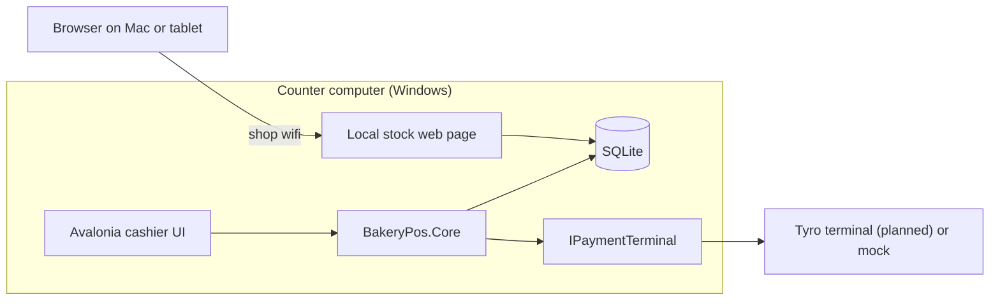

# Architecture

## Overview

The till computer is the single source of truth. Sales and stock counts live in a local database on that machine. Other devices only view stock; they never change data.

## Key decisions

**Avalonia instead of WPF.** The till runs Windows, but development happens on macOS. Avalonia lets the same UI run on both. Windows-only code (the Tyro adapter, cash drawer, printer) is isolated so the rest of the app stays portable.

**Hardware and payments behind interfaces.** `IPaymentTerminal` has a mock implementation used for development, tests and demos. The real Tyro implementation will be added once certification is in place, without changing the business logic.

**Stock changes only on approved payments.** A declined or cancelled card payment leaves stock untouched. Money amounts are stored as integer cents, never floating point.

**Local network stock page, not a hosted service.** The stock board is served by the till computer and opened from any device on the shop wifi. This costs nothing to run and keeps sales data inside the shop. It needs a PIN so other devices on the network can't read it.

**Local-first storage.** SQLite on the till keeps the shop trading if the internet drops.

## Known constraints

- Tyro requires integrations to be certified before production use. Card payments stay on the mock terminal until that is done.
- The Windows-specific hardware code can only be proven on the real till.
